# Chocolate Kizomba

**Live site:** [kalila19.github.io/chocolate-kizomba](https://kalila19.github.io/chocolate-kizomba/)

Chocolate Kizomba is a weekly Kizomba class and social night every Tuesday at Be At One, Regent Street, in Soho, London. This website has been created as part of the Code Institute HTML, CSS and Bootstrap curriculum. The project focuses on building an interactive, responsive multi-page site using front-end languages that is visually appealing and provides a seamless user experience. The website introduces the night to new dancers, explains the classes and prices, and gives people an easy way to book classes, sign up for a free class or get in touch.

---

## Table of Contents

- [User experience](#user-experience)
  - [Target audience](#target-audience)
  - [User goals](#user-goals)
  - [Site owner goals](#site-owner-goals)
  - [User stories](#user-stories)
    - [User story 1 – Finding suitable classes](#user-story-1--finding-suitable-classes-must-have)
    - [User story 2 – Discovering Kizomba](#user-story-2--discovering-kizomba-must-have)
    - [User story 3 – Getting in touch](#user-story-3--getting-in-touch-must-have)
    - [User story 4 – Understanding the organisers](#user-story-4--understanding-the-organisers-should-have)
    - [User story 5 – Finding events](#user-story-5--finding-events-must-have)
- [Design](#design)
  - [Colour palette](#colour-palette)
  - [Typography](#typography)
  - [Imagery](#imagery)
  - [Layout](#layout)
  - [Wireframes](#wireframes)
- [Features](#features)
  - [Header & navigation](#header--navigation)
    - [Hero images](#hero-images)
    - [Page fade](#page-fade)
  - [Footer](#footer)
  - [Home page](#home-page)
  - [Classes page](#classes-page)
  - [Contact us page](#contact-us-page)
  - [Success page](#success-page)
  - [Thank you page](#thank-you-page)
  - [Under construction page](#under-construction-page)
- [Future features](#future-features)
- [Accessibility](#accessibility)
- [Technologies](#technologies)
- [Testing & validation](#testing--validation)
- [Deployment](#deployment)
  - [Deploying to GitHub Pages](#deploying-to-github-pages)
  - [Running the project locally](#running-the-project-locally)
- [AI declaration](#ai-declaration)
  - [What AI was used for](#what-ai-was-used-for)
  - [What I did myself](#what-i-did-myself)
  - [How I checked AI output](#how-i-checked-ai-output)
- [Credits](#credits)

---

## User experience

### Target audience

- People in London curious about trying Kizomba for the first time
- Dancers with some experience looking for a regular class and social
- Existing community members checking times, prices and upcoming news

### User goals

- Understand what Chocolate Kizomba is and what a Tuesday night involves
- Find class times, levels and prices quickly
- Book a class or sign up for a free first class
- Find out how to get there
- Ask a question and get a reply

### Site owner goals

- Bring new dancers to the Tuesday classes
- Grow the mailing list
- Reflect the friendly, welcoming feel of the community
- Increase engagement and conversions
- Strengthen brand identity and online visibility
- Attract new audiences
- Improve event promotion
- Support future growth

### User stories

The following user stories guided the design and development of Chocolate Kizomba. Each one notes what the current site already provides. Features still to be built are listed under [Future features](#future-features).

#### User story 1 – Finding suitable classes (Must have)

*Beginner*

As a beginner interested in learning Kizomba, I want to find upcoming classes and workshops that are suitable for my experience level, so that I can participate without feeling intimidated or out of my depth.

Potential website features:

- Upcoming classes and workshops
- Beginner, improver and intermediate labels
- Class descriptions and learning objectives
- Dates, times, locations and prices
- Clear booking or registration link

**What has been met:** The Classes page sets out the day, schedule, levels (Beginners, Improvers and Advanced), prices and venue, with a clear "Book a class" button and a "Book now!" button on the Home page. The instructor cards describe what each level covers, helping visitors choose the right class.

**Still to come:** A Workshops page and fuller class descriptions with learning objectives for each level.

#### User story 2 – Discovering Kizomba (Must have)

*New visitor*

As someone who has never danced Kizomba before, I want to understand what Kizomba is and what makes it different from other dance styles, so that I can decide whether it is something I would like to learn.

Potential website features:

- An introduction to Kizomba
- Information about its Angolan roots and cultural significance
- Photos and videos demonstrating the dance
- Information about what to expect at a beginner class (FAQs to confirm levels)

**What has been met:** The Home page introduces Chocolate Kizomba through a hero headline, photo carousel and "Why dance with us?" cards, which show the atmosphere and mention the music (Kizomba and Semba). The Classes page FAQs explain what to expect as a beginner, including that no experience or partner is needed and what to wear.

**Still to come:** A "What is Kizomba?" section covering its Angolan roots and cultural significance, and short videos of the dance.

#### User story 3 – Getting in touch (Must have)

*New or existing visitor*

As someone interested in attending a class or collaborating with Chocolate Kizomba, I want to find an easy way to contact the organisers, so that I can ask questions and receive further information.

Potential website features:

- Contact form
- Social media links
- Email contact information
- FAQs

**What has been met:** The Contact page has a contact form with a subject dropdown, sent through Web3Forms, and a "Message sent" page confirming it worked. Every page's footer includes a clickable email address, social media links (Instagram, Facebook, TikTok and WhatsApp) and quick links to the FAQs.

#### User story 4 – Understanding the organisers (Should have)

*Potential participant*

As someone considering attending a Chocolate Kizomba event, I want to learn more about the organisers and their experience, so that I can feel comfortable and confident about participating.

Potential website features:

- About Us section
- Organiser and instructor introductions
- Photos from previous events
- The story and values behind Chocolate Kizomba

**What has been met:** The "Meet your instructors" section on the Classes page introduces each instructor with a photo and short bio describing their experience and the level they teach. Photos from previous nights appear throughout the site, and the Home page reflects the brand's values: "Community. Connection. Culture".

**Still to come:** An About Us page telling the story and values behind Chocolate Kizomba.

#### User story 5 – Finding events (Must have)

*Existing dancer*

As an existing Kizomba dancer, I want to find upcoming social events, workshops and dance experiences, so that I can continue developing my skills and connect with other dancers. I also want to find out which DJ is playing this week.

Potential website features:

- Events calendar
- Event descriptions
- Guest teachers and DJs
- Venue information
- Ticket and booking links

**What has been met:** The weekly Tuesday class and social are described on the Classes page, with times, prices and an FAQ explaining what happens at the social. Venue details appear in every footer, and the Contact page has a "Get Directions" button linking to Google Maps.

**Still to come:** An Events page with a calendar, and a weekly "This Tuesday" section naming the DJ.

---

## Design

### Colour palette

| Colour        | Hex       | CSS variable         | Used for                     |
| ------------- | --------- | -------------------- | ---------------------------- |
| Dark Amethyst | `#45134f` | `--primary-color`    | Navbar, footer, hero overlay |
| Cocoa Brown   | `#5b3a32` | `--secondary-color`  | Main body text               |
| Royal Orchid  | `#8125a0` | `--highlight-color`  | Links and button hover       |
| Pumpkin Spice | `#f47b35` | `--accent-color`     | Call-to-action buttons       |
| Sunlit Clay   | `#deb46d` | `--clay-color`       | Current page in the navbar   |
| Ivory/Linen   | `#f6f0e8` | `--background-color` | Page background, footer text |
| Charcoal      | `#17131a` | `--dark-color`       | Button text                  |
| White         | `#ffffff` | `--white-color`      | Hero text                    |

The palette was generated using Coolors. All colours are stored as CSS variables in `:root`, so they're used consistently and can be changed in one place.

All text and background combinations meet WCAG AA contrast (4.5:1 for normal text), as shown in the image above:

| Combination                  | Ratio  |
| ---------------------------- | ------ |
| Cocoa Brown on Ivory         | 8.8:1  |
| Royal Orchid on Ivory        | 6.9:1  |
| Charcoal on Pumpkin Spice    | 6.8:1  |
| Ivory on Royal Orchid        | 6.9:1  |
| Ivory on Dark Amethyst       | 12.7:1 |
| Sunlit Clay on Dark Amethyst | 7.4:1  |

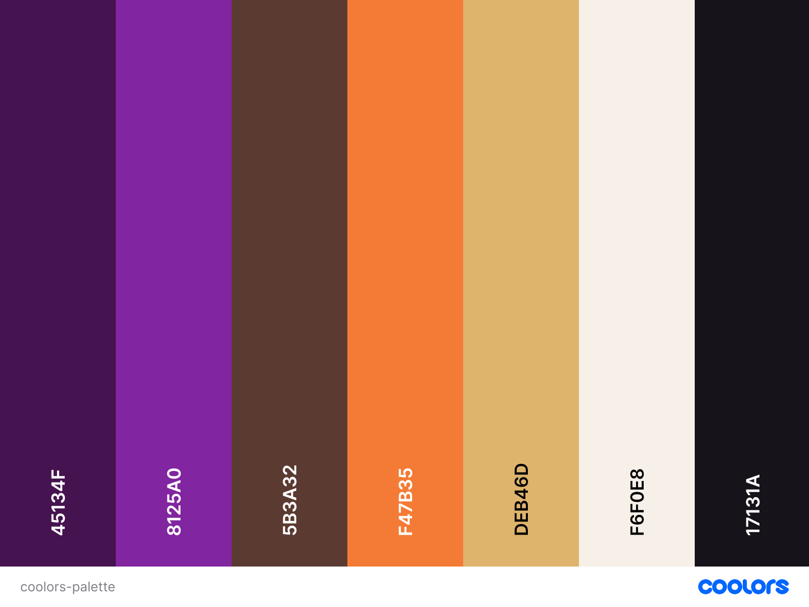

### Typography

- **Montserrat** for headings, card titles and FAQ questions (`--secondary-font`)
- **Poppins** for body text (`--primary-font`)

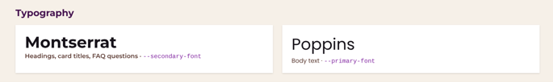

Both fonts come from Google Fonts. They were chosen because they create a balanced contrast that is easy to read.

The fonts are loaded with a `<link>` in the `<head>` of each page, with `preconnect` hints, and only the weights the site actually uses are requested:

- **Montserrat:** 300 to 700. It's a variable font, so one file covers every weight, including the custom 650 used for headings.
- **Poppins:** 300, 400, 600, 700 and italic 400.

See [Performance](TESTING.md#performance) in TESTING.md for why this replaced the original CSS `@import`.

### Imagery

The photos are from Chocolate Kizomba nights at Be At One, focusing on the social, community atmosphere and snippets from classes. They were taken by a friend who organises the event.

- All photos and logos are saved as **WebP**, which gives smaller files than JPG or PNG at the same visual quality. The logos keep their transparent backgrounds.
- Photos were resized to suit the size they're displayed at (mostly 960–1080px wide) and compressed at quality 78, so pages load quickly without looking blurry.
- Every image has descriptive `alt` text.
- Images below the fold use `loading="lazy"`, and the hero images use `fetchpriority="high"` (see [Performance](TESTING.md#performance)).

### Layout

The site is built mobile-first with Bootstrap's grid, with layout changes at 576px, 768px, 992px and 1200px. For example, the "Why dance with us?" cards show one per row on phones, two on tablets and four on desktops.

### Wireframes

Initial wireframes were sketched by hand at the concept stage. The digital wireframes below were generated with Claude from the finished site's HTML and CSS, so they show the layout as built at desktop, tablet (768px) and mobile sizes.

| Page                     | Desktop                                                                            | Tablet                                                                           | Mobile                                                                           |
| ------------------------ | ---------------------------------------------------------------------------------- | -------------------------------------------------------------------------------- | -------------------------------------------------------------------------------- |
| Home                     |                        |                        |                        |
| Classes                  |                  | 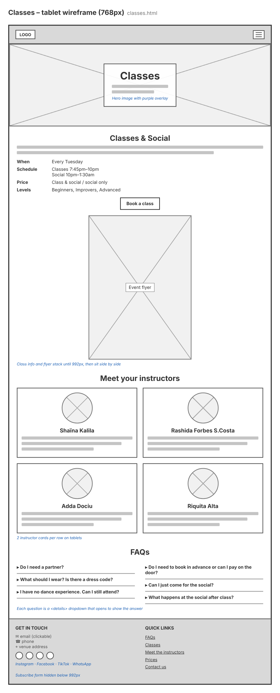                 | 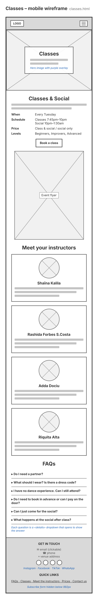                 |
| Contact Us               | 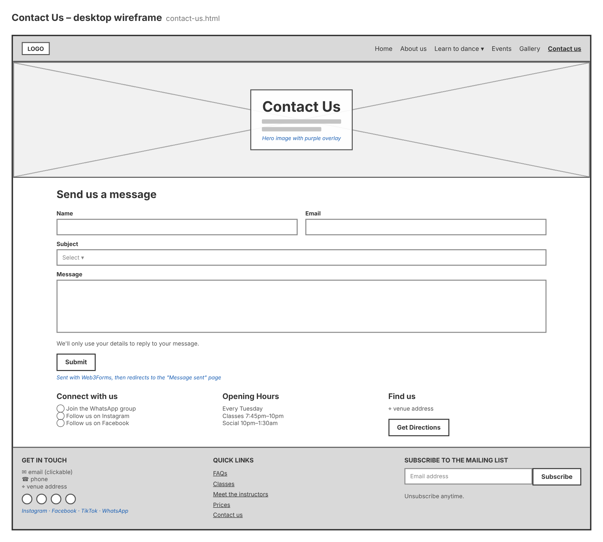                 |                  |                  |
| Message sent / Thank you | 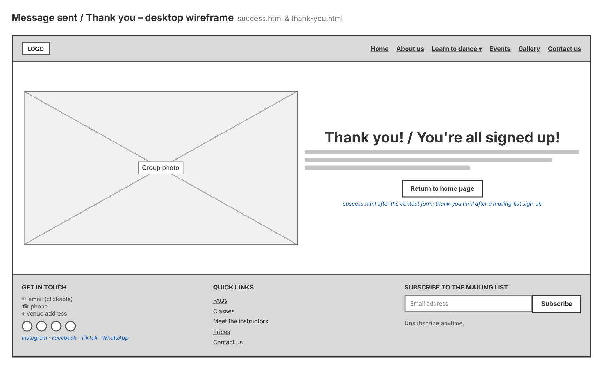       | 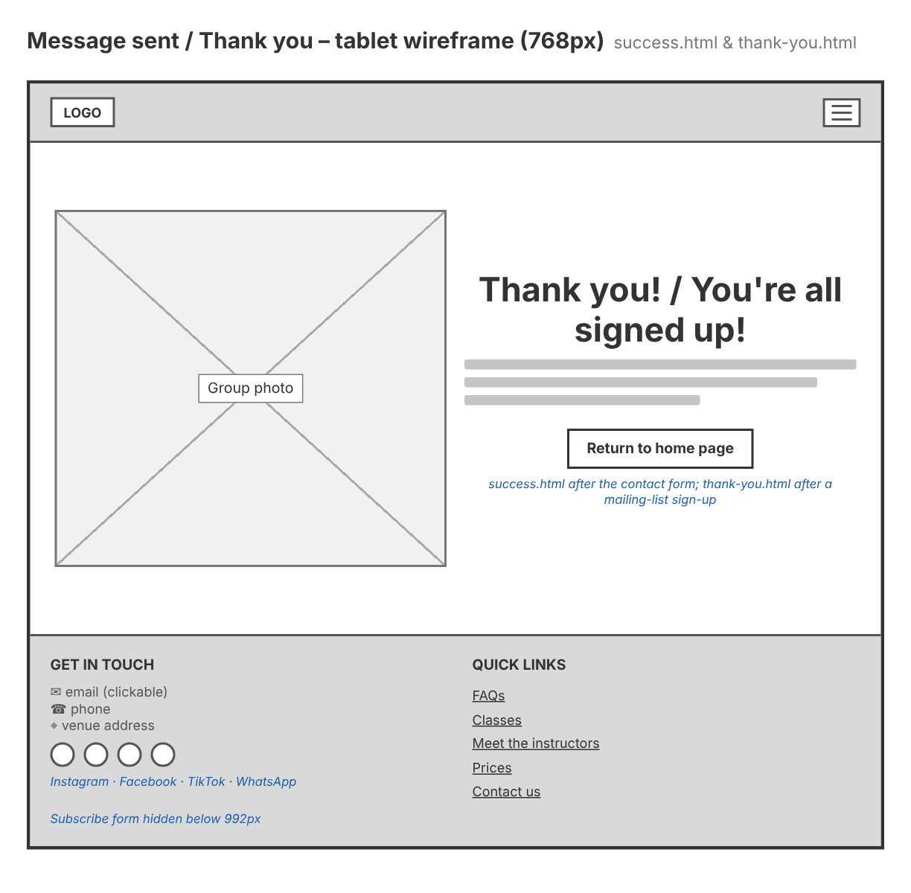       | 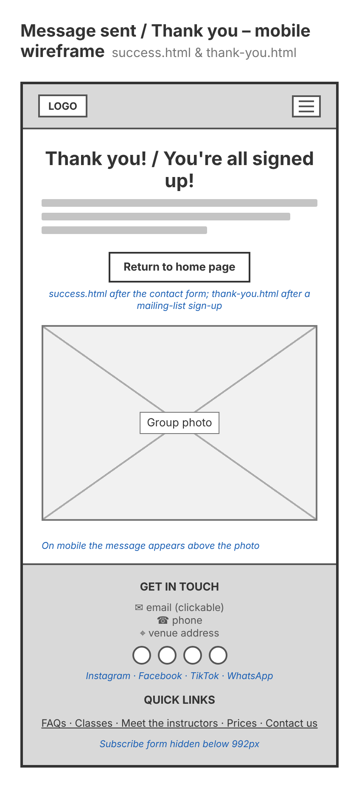       |

---

## Features

### Header & navigation

The navbar appears on every page.

- **Fixed to the top** of the screen, so it's always available. The logo links back to the home page.
- **Highlights the current page** in Sunlit Clay, using Bootstrap's `active` class and `aria-current="page"`.
- **Collapses into a menu button below 992px.** "Learn to dance" opens a dropdown with Classes and Workshops.
- **Built with Bootstrap,** then customised in CSS: background colour, link colours and hover colour.
- **Linked sections land correctly.** `body` has `padding-top` so the fixed navbar doesn't cover the hero, and `html` has `scroll-padding-top` so headings reached from links aren't hidden underneath it.

| Desktop                                                | Tablet                                                    | Mobile                                                    |
| ------------------------------------------------------ | --------------------------------------------------------- | --------------------------------------------------------- |
|  | 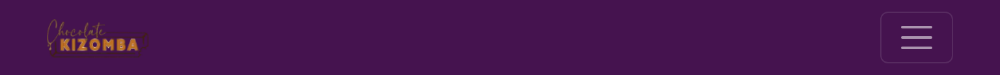      |       |
| Full menu shown from 992px                             | 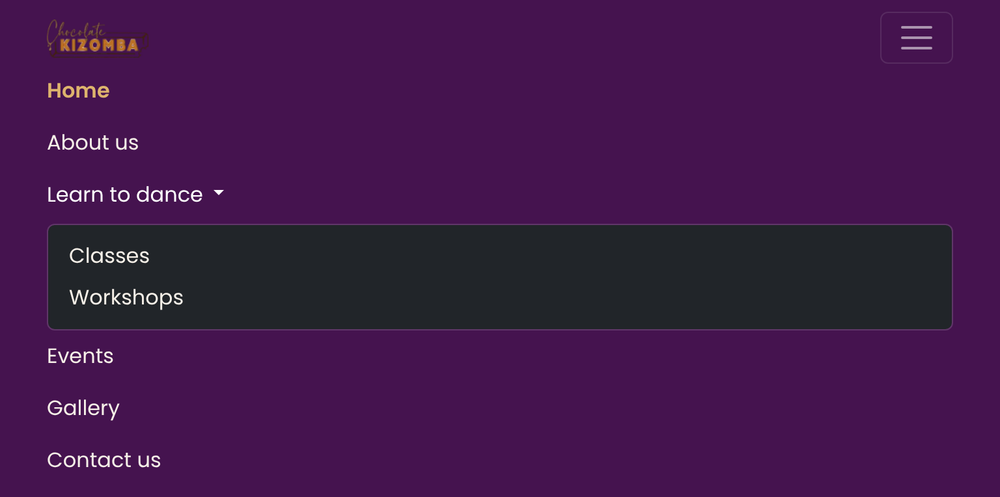 |  |

#### Hero images

Each main page opens with a full-width hero image and a purple overlay (Dark Amethyst at 55% opacity), which keeps the white text readable over the photo at every size. The hero uses `min-height` rather than a fixed height, so it grows to fit its text on small phones instead of cutting it off.

| Desktop                                            | Tablet                                           | Mobile                                           |
| -------------------------------------------------- | ------------------------------------------------ | ------------------------------------------------ |
| 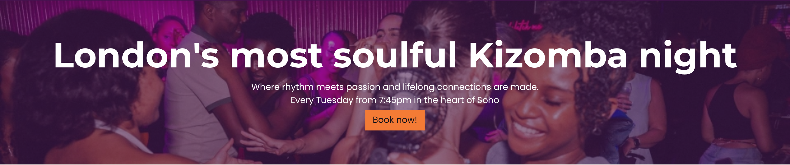 | 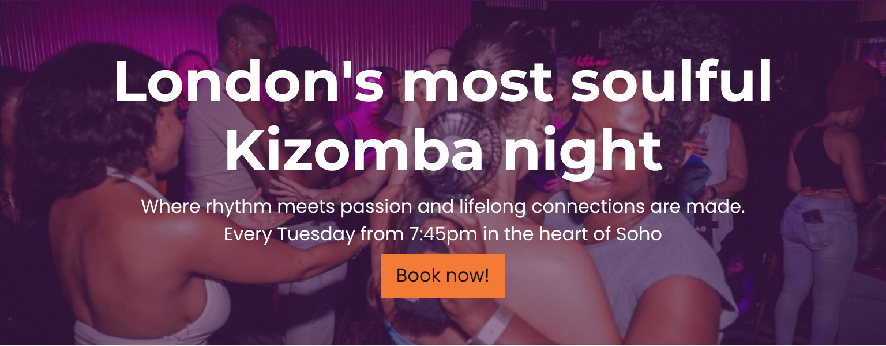 |  |

#### Page fade

Each page fades in over 0.2 seconds when it loads. This was shortened from 0.4 seconds to improve performance (see [Performance](TESTING.md#performance)), and it's switched off for visitors who have reduced motion turned on.

### Footer

The footer appears on every page and contains:

- **Get in touch:** a clickable email address, a phone number, the venue address, and links to Instagram, Facebook, TikTok and the WhatsApp group. Each link opens in a new tab and has an `aria-label`.
- **Quick links:** jump to FAQs, Classes, Meet the instructors, Prices and Contact us.
- **Mailing list sign-up:** sent through Web3Forms, then redirects to the thank-you page. It's shown from 992px wide only, because the home page already has a sign-up form near the top and this keeps the footer short on phones.

| Desktop                                                | Tablet                                               | Mobile                                               |
| ------------------------------------------------------ | ---------------------------------------------------- | ---------------------------------------------------- |
| 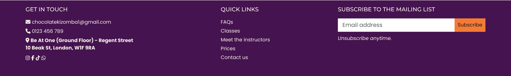 | 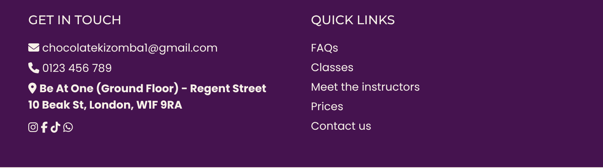 | 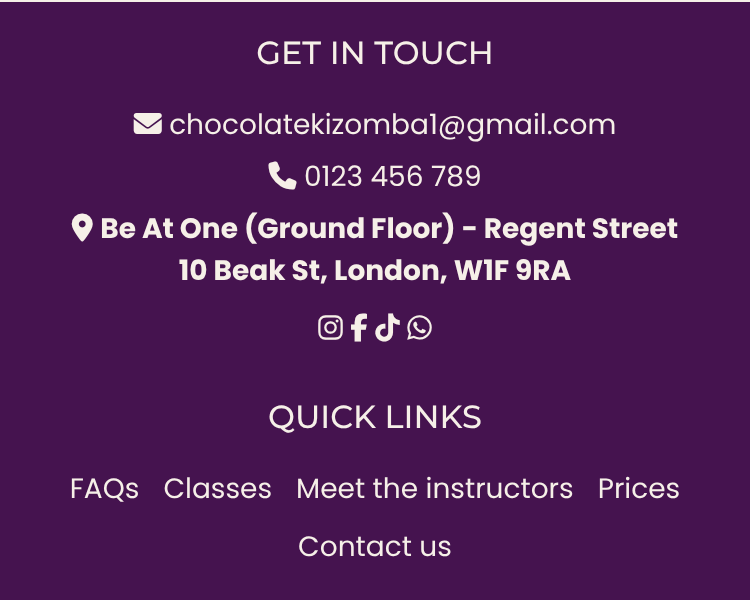 |

The footer has three columns on desktop. On smaller screens the subscribe form is hidden and the columns stack.

### Home page

File: `index.html`

- **Hero:** the headline "London's most soulful Kizomba night" and a **Book now!** button linking to the Afromoya booking page. The button is built with Bootstrap and styled through Bootstrap's `--bs-btn-*` variables, so the hover, click and keyboard focus states all use the site's palette.
- **Photo carousel:** 10 landscape photos from previous nights, with previous and next controls. Only landscape photos are used, so the carousel doesn't jump in height between slides. Every slide after the first uses `loading="lazy"`.
- **Free class sign-up:** an email form next to the carousel, sent through Web3Forms and redirecting to the thank-you page. On mobile the text and form appear above the carousel, so the sign-up is seen first.
- **"Why dance with us?" cards:** four Bootstrap cards covering levels for everyone, community, music and confidence. The card images are circular and the cards have sharp corners instead of Bootstrap's default rounded corners.

### Classes page

File: `classes.html`

- **Class and social details:** schedule, prices and levels in a description list (`<dl>`), alongside the event flyer.
- **Book a class:** a button linking to the Afromoya booking page, styled the same way as the other buttons.
- **Meet your instructors:** four Bootstrap cards with circular photos and short bios explaining which level each instructor teaches.
- **FAQs:** expandable `
` sections. A Bootstrap accordion was considered, but it would take up a lot of space for such a small section, and `
` works without JavaScript and is keyboard-accessible by default.

### Contact us page

File: `contact-us.html`

- **Contact form:** name, email, subject and message fields, built with Bootstrap.
  - Every field is required and labelled, with `autocomplete` on name and email.
  - The form is sent through Web3Forms and redirects to the "Message sent" page.
  - A hidden checkbox catches spam bots.
- **Connect with us:** links to WhatsApp, Instagram and Facebook.
- **Opening hours.**
- **Find us:** the venue address and a **Get Directions** button that opens Google Maps.

The form and the three columns share the same centred column, so their edges line up.

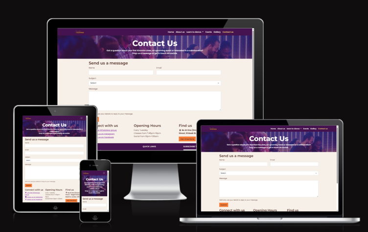

### Success page

File: `success.html`, the "Message sent" page.

- Shown after the contact form is submitted, so visitors get immediate confirmation that their message was sent.
- Links back to the home page.
- Hidden from search engines with `noindex`.

### Thank you page

File: `thank-you.html`, the "Signed up" page.

- Shown after someone joins the mailing list, from either the free-class sign-up on the home page or the footer sign-up on any page.
- Confirms the sign-up and links back to the home page.
- Hidden from search engines with `noindex`.

### Under construction page

File: `under-construction.html`

- A placeholder for sections that aren't built yet. About us, Workshops, Events and Gallery all link here from the navbar.
- Tells visitors the page is on its way and links back to the home page, so the navbar never leads to a dead link.
- Hidden from search engines with `noindex`.

---

## Future features

- **About us page:** the story behind Chocolate Kizomba and the team, plus a "What is Kizomba?" section explaining its Angolan roots and cultural significance, with short video highlights.
- **Workshops page:** upcoming workshops with booking links, under "Learn to dance", and fuller class descriptions with learning objectives for each level.
- **Events page:** a calendar of socials, special events and guest teachers, plus a weekly "This Tuesday" section showing the DJ playing that week, with a direct booking link.
- **Gallery page:** photos and videos from past nights.
- **Mailing list:** move the free-class and footer sign-up forms from Web3Forms to Mailjet, so subscribers go straight onto a mailing list instead of arriving as emails.
- **Privacy policy page,** linked from the sign-up forms.

The About us, Workshops, Events and Gallery links already appear in the navbar to show the planned site structure. Until those pages are built, they open the under construction page.

---

## Accessibility

- Semantic HTML elements (`header`, `nav`, `main`, `section`, `footer`, `address`, `dl`, `details`)
- Logical heading order on every page (`h1`, then `h2`, then `h3`), using Bootstrap's heading classes to control size separately
- Descriptive `alt` text for every image
- Labels for every form field, with `autocomplete` to help people fill them in
- `aria-label`s on icon-only links (the footer social icons), with decorative icons hidden from screen readers
- `aria-current="page"` on the current navbar link
- Colour contrast meeting WCAG AA throughout (see [Colour palette](#colour-palette))
- Visible focus and hover states on buttons and links
- Keyboard-friendly navigation, including the collapsible menu and the FAQ `
`
- `lang="en-GB"` on every page
- Fade animation switched off for visitors with reduced motion turned on

---

## Technologies

- HTML5 and CSS3
- [Bootstrap 5.3.9](https://getbootstrap.com/): grid, navbar, carousel, cards and forms
- [Font Awesome](https://fontawesome.com/): icons
- [Google Fonts](https://fonts.google.com/): Montserrat and Poppins
- [Web3Forms](https://web3forms.com/): sends contact form messages and mailing list sign-ups to email
- [favicon.io](https://favicon.io/): favicons
- [Coolors](https://coolors.co/): colour palette
- [W3C Markup Validation Service](https://validator.w3.org/) and [W3C CSS Validation Service](https://jigsaw.w3.org/css-validator/): code validation
- Chrome DevTools and Lighthouse: responsiveness, performance and accessibility testing
- Git, GitHub and GitHub Pages: version control and hosting
- Visual Studio Code with Live Server
- [Claude](https://claude.ai/): see [AI declaration](#ai-declaration)

---

## Testing & validation

Full testing and validation results, with screenshots, are in [TESTING.md](TESTING.md).

---

## Deployment

The site is deployed with **GitHub Pages** from the `main` branch.

### Deploying to GitHub Pages

1. Push the code to the GitHub repository.
2. In the repository, go to **Settings → Pages**.
3. Under **Build and deployment**, set **Source** to **Deploy from a branch**.
4. Choose the **main** branch and the **/ (root)** folder, then click **Save**.
5. After a minute or two, the site is live at [kalila19.github.io/chocolate-kizomba](https://kalila19.github.io/chocolate-kizomba/).
6. Every push to `main` redeploys the site automatically. To check the live site matches the latest code, wait for the **pages build and deployment** workflow on the **Actions** tab to finish, then refresh the site.

The contact and sign-up forms redirect to `success.html` and `thank-you.html` using the **full live URL**, because Web3Forms sends the visitor back from its own server. These redirects only work on the deployed site, not when the pages are opened locally.

### Running the project locally

1. Clone the repository:
   `git clone https://github.com/Kalila19/chocolate-kizomba.git`
2. Open the folder in Visual Studio Code.
3. Open `index.html` with the **Live Server** extension, or open it directly in a browser.

---

## AI declaration

I used Claude (Anthropic's AI assistant) as a support tool during this project. All design decisions and content choices are my own, and I reviewed, tested and understood any suggestions before using them.

### What AI was used for

- **Project review:** comparing my repository with the submission checklist and producing progress checklists, which highlighted outstanding items such as lazy loading, placeholder navigation links, form feedback and missing README sections.
- **Wireframes:** the digital desktop, tablet and mobile wireframes were generated by Claude from my finished HTML and CSS.
- **Colour palette image and README screenshots:** the palette image (with contrast ratios) and the navbar, hero and footer screenshots in `assets/readme/` were generated by Claude from my code.
- **Performance:** help understanding my Lighthouse results and what to change. Claude re-compressed the WebP images, resized the thank-you image, and explained how to load Google Fonts with `preconnect` and only the weights used.
- **Debugging:** help finding the missing `
` in the carousel and restoring `contact-us.html` from git.
- **README:** help structuring and expanding this README, including the Performance and Deployment sections, and drafting this declaration.

### What I did myself

- Planned the site structure, pages and content
- Wrote the HTML and CSS and built the layouts with Bootstrap
- Chose the colour palette, fonts and photos
- Wrote the page text, instructor bios and FAQs
- Set up Web3Forms, deployed to GitHub Pages and carried out the testing

### How I checked AI output

I tested all AI-suggested changes in the browser at different screen sizes, ran the pages through the W3C HTML and CSS validators and Lighthouse, and only kept changes I understood and could explain.

---

## Credits

- Layout components: [Bootstrap](https://getbootstrap.com/)
- Colour palette: [Coolors](https://coolors.co/)
- Icons: [Font Awesome](https://fontawesome.com/)
- Fonts: [Google Fonts](https://fonts.google.com/)
- Favicons: [favicon.io](https://favicon.io/)
- Contact form and sign-up handling: [Web3Forms](https://web3forms.com/)
- Bookings: [Afromoya](https://www.afromoya.com/)
- Wireframes, colour palette image and navbar/hero/footer screenshots: generated with [Claude](https://claude.ai/)
- Photos: Chocolate Kizomba, taken by the event organiser and used with permission
