# Chocolate Kizomba

Chocolate Kizomba is a weekly Kizomba class and social night every Tuesday at Be At One, Regent Street, in Soho, London. This website has been created as part of the Code Institute HTML, CSS, Bootstrap curriculum. The project focuses on building an interactive and responsive multi-page site using front-end languages to make it visually appealing and providers a seamless user experience. This website introduces the night to new dancers, explains the classes and prices, and gives people an easy way to book classes, sign up for a free class or get in touch.

**Live site:** [kalila19.github.io/chocolate-kizomba](https://kalila19.github.io/chocolate-kizomba/)

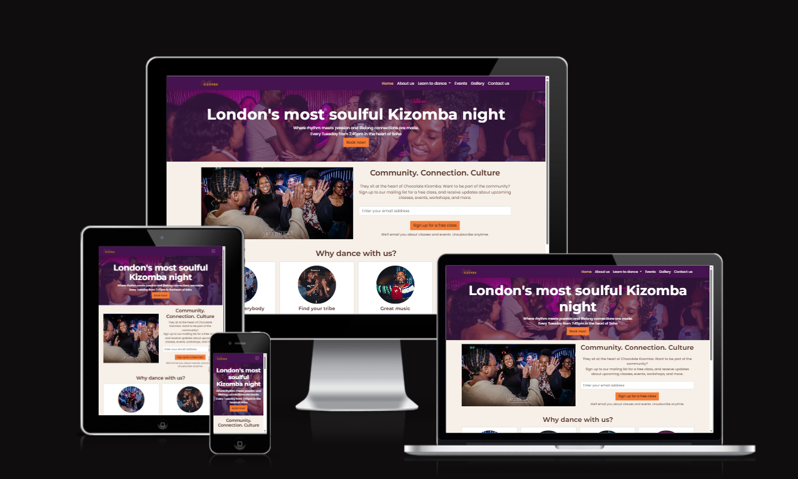

---

## Table of Contents

- [User experience](#user-experience)
- [Design](#design)
  - [Colour palette](#colour-palette)
  - [Typography](#typography)
  - [Imagery](#imagery)
  - [Wireframes](#wireframes)
- [Features](#features)
  - [Header & navigation](#header--navigation)
  - [Footer](#footer)
  - [Home page](#home-page)
  - [Classes page](#classes-page)
  - [Contact us page](#contact-us-page)
  - [Success page](#success-page)
  - [Thank you page](#thank-you-page)
  - [Under construction page](#under-construction-page)
- [Future features](#future-features)
- [Accessibility](#accessibility)
- [Technologies](#technologies)
- [Testing](#testing)
- [Bugs fixed](#bugs-fixed)
- [Deployment](#deployment)
- [AI Declaration](#ai-declaration)
- [Credits](#credits)

---

## User experience

### Target audience

- People in London curious about trying Kizomba for the first time
- Dancers with some experience looking for a regular class and social
- Existing community members checking times, prices and upcoming news

### User goals

- Understand what Chocolate Kizomba is and what a Tuesday night involves
- Find class times, levels and prices quickly
- Book a class or sign up for a free first class
- Find out how to get there
- Ask a question and get a reply

### Site owner goals

- Bring new dancers to the Tuesday classes
- Grow the mailing list
- Reflect the friendly, welcoming feel of the community
- Increase engagement and conversions
- Strengthen brand identity and online visibility
- Attract new audiences
- Improve event promotion
- Support future growth

### User Stories

The following user stories were used to guide the design and development of Chocolate Kizomba. I have added
notes for features that have been met with the websites that have been built at the time of writing this. Later on in the document I will mention future features that are due to be added.

---

User story 1 – Finding suitable classes (must have)

Beginner

As a beginner interested in learning Kizomba, I want to find upcoming classes and workshops that are suitable for my experience level, so that I can participate without feeling intimidated or out of my depth.

Potential website features:

- Upcoming classes and workshops.
- Beginner, improver and intermediate labels.
- Class descriptions and learning objectives.
- Dates, times, locations and prices.
- Clear booking or registration link.

**What has been met:** The Classes page sets out the day, schedule, levels (Beginners, Improvers and Advanced), prices and venue, with a clear "Book a class" button and a "Book now!" button on the Home page. The instructor cards describe what each level covers, helping visitors choose the right class.

---

User story 2 – Discovering Kizomba (Must have)

New visitor

As someone who has never danced Kizomba before, I want to understand what Kizomba is and what makes it different from other dance styles, so that I can decide whether it is something I would like to learn.

Potential website features:

- An introduction to Kizomba.
- Information about its Angolan roots and cultural significance.
- Photos and videos demonstrating the dance.
- Information about what to expect at a beginner class (FAQS to confirm levels)

**What has been met:** The Home page introduces Chocolate Kizomba through a hero headline, photo carousel and "Why dance with us?" cards, which show the atmosphere and mention the music (Kizomba and Semba). The Classes page FAQs explain what to expect as a beginner, including that no experience or partner is needed and what to wear.

---

User story 3 – Getting in touch (must have)

New or existing visitor

As someone interested in attending a class or collaborating with Chocolate Kizomba, I want to find an easy way to contact the organisers, so that I can ask questions and receive further information.

Potential website features:

- Contact form.
- Social media links.
- Email contact information.
- FAQS

**What has been met:** The Contact page has a contact form with a subject dropdown, sent through Web3Forms, and a "Message sent" page confirming it worked. Every page's footer includes a clickable email address, social media links (Instagram, Facebook, TikTok and WhatsApp) and quick links to the FAQs.

---

User story 4 – Understanding the organisers (should have)

Potential participant

As someone considering attending a Chocolate Kizomba event, I want to learn more about the organisers and their experience, so that I can feel comfortable and confident about participating.

Potential website features:

- About Us section.
- Organiser and instructor introductions.
- Photos from previous events.
- The story and values behind Chocolate Kizomba

**What has been met:** The "Meet your instructors" section on the Classes page introduces each instructor with a photo and short bio describing their experience and the level they teach. Photos from previous nights appear throughout the site, and the Home page reflects the brand's values: "Community. Connection. Culture".

---

User story 5 – Finding events (must have)

Existing dancer

As an existing Kizomba dancer, I want to find upcoming social events, workshops and dance experiences, so that I can continue developing my skills and connect with other dancers. I also want to find what DJ is playing this week.

Potential website features:

- Events calendar.
- Event descriptions.
- Guest teachers and DJs.
- Venue information.
- Ticket and booking links

**What has been met:** The weekly Tuesday class and social are described on the Classes page, with times, prices and an FAQ section explaining what happens at the social. Venue details appear in every footer, and the Contact page has a "Get Directions" button linking to Google Maps for ease of access.

---

## Design

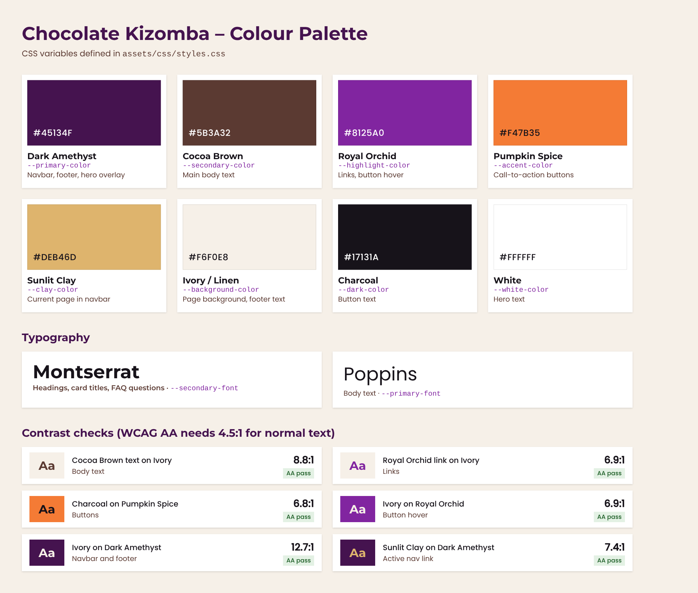

### Colour palette

| Colour        | Hex       | Used for                     |
| ------------- | --------- | ---------------------------- |
| Dark Amethyst | `#45134f` | Navbar, footer, hero overlay |
| Cocoa Brown   | `#5b3a32` | Main body text               |
| Royal Orchid  | `#8125a0` | Links and button hover       |
| Pumpkin Spice | `#f47b35` | Call-to-action buttons       |
| Sunlit Clay   | `#deb46d` | Current page in the navbar   |
| Ivory/Linen   | `#f6f0e8` | Page background, footer text |
| Charcoal      | `#17131a` | Button text                  |

All text and background combinations were chosen to meet WCAG AA contrast. For example, Charcoal text on the orange buttons has a contrast ratio of about 6.8:1 (as shown on image above). The colour palette was generated usings Coolors palette. The only addition

### Typography

- **Montserrat** for headings, card titles and FAQ questions
- **Poppins** for body text

Both are loaded from Google Fonts (as shown above). They have been selected as they create a balanced contrast throughout the page that is easy to read by users.

### Imagery

Photos are from Chocolate Kizomba nights at Be At One focusing on the social, community atmosphere and snippets from classes. They were taken by my friend who is the organiser of the event. They were resized (maximum 1920px wide) and compressed so pages load quickly.

All photos and logos are saved as WebP so the file size is smaller compared to JPG and PNG whilst maintaining the same visual quality. The logos keep their transparent backgrounds. All images are responsive and include descriptive alt text where appropriate.

### Wireframes

Initial wireframes were drawn by hand at the point of concept and then uploaded to Claude to generate digital wireframes.

Screen size

| Screen size          | Wireframe                                                                                   |
| -------------------- | ------------------------------------------------------------------------------------------- |
| Home Desktop         | 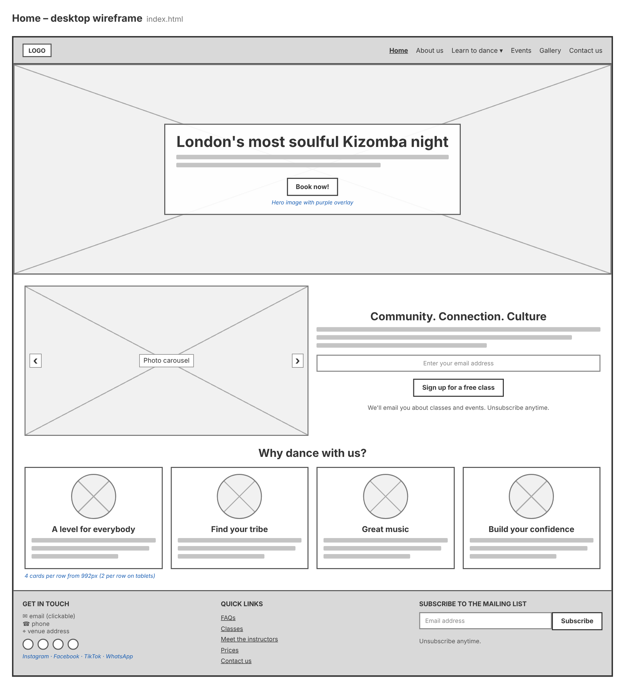                    |
| Home Tablet          | 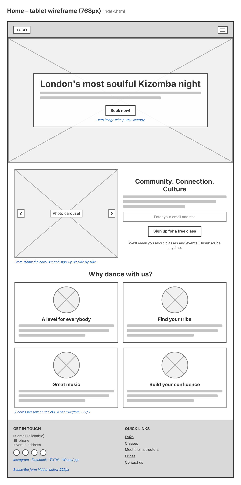                      |
| Home Mobile          | 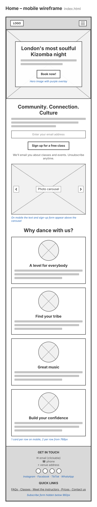                      |
| Classes Desktop      | 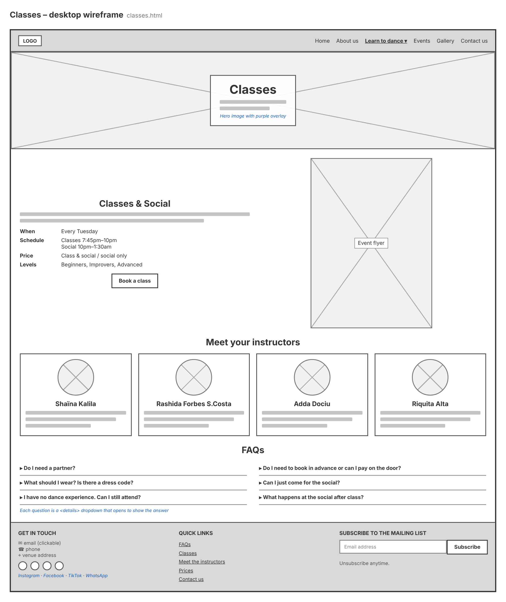              |
| Classes Tablet       |                 |
| Classes Mobile       |                 |
| Contact Desktop      |               |
| Contact Tablet       | 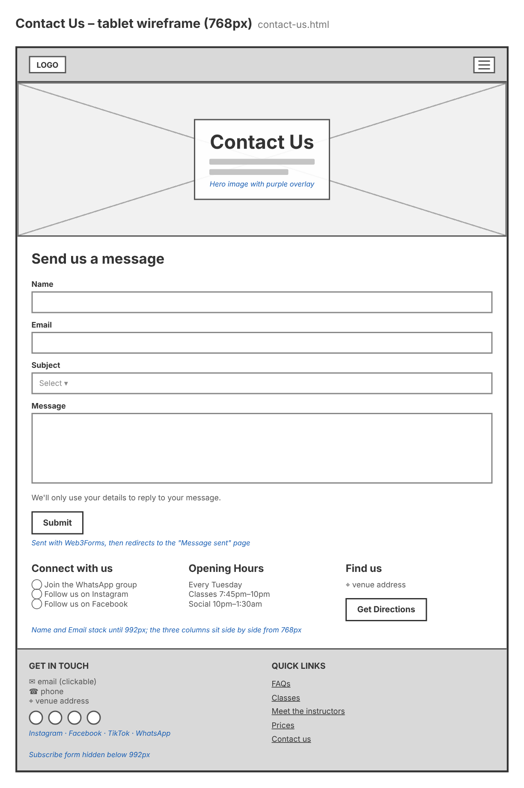                |
| Contact Mobile       | 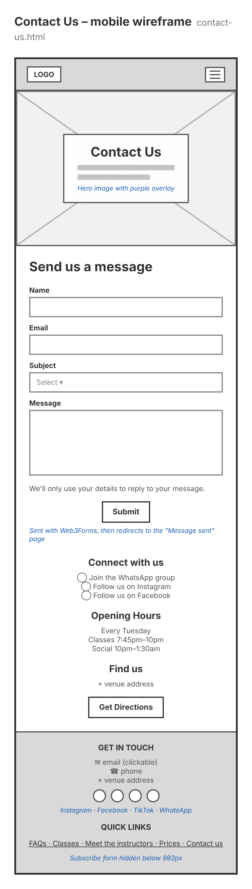                |
| Confirmation Desktop |     |
| Confirmation Tablet  |  |
| Confirmation Mobile  |       |

---

## Features

### Header & navigation (on every page)

- **Navbar:** fixed to the top of the screen, with the logo linking home. The current page is highlighted. On small screens it collapses into a burger menu button. Used Bootstrap to create navbar and used CSS to customise the bar, the colour of the links when hovered and the colour of the "active" page.

#### Navbar

| Desktop                                                | Tablet                                                    | Mobile                                                    |
| ------------------------------------------------------ | --------------------------------------------------------- | --------------------------------------------------------- |
|  |       |       |
| Full menu shown from 992px                             |  | 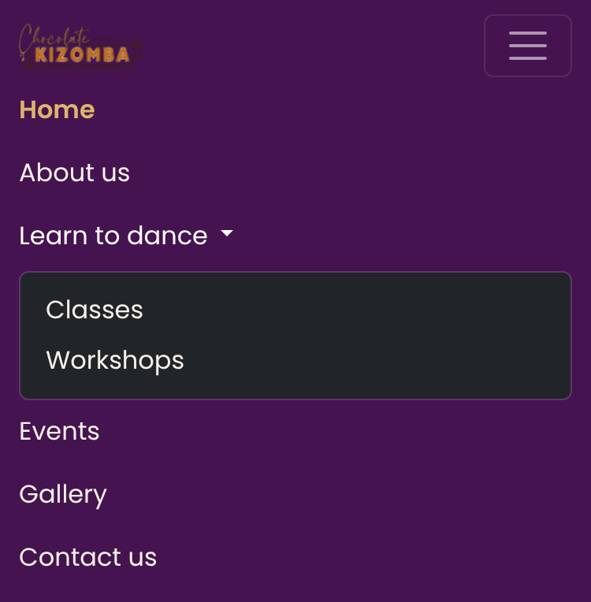 |

Below 992px the links collapse into a menu button. The current page the user is on is highlighted in Sunlit Clay.

#### Hero image (home page)
| Desktop | Tablet | Mobile |
|---|---|---|
|  |  | 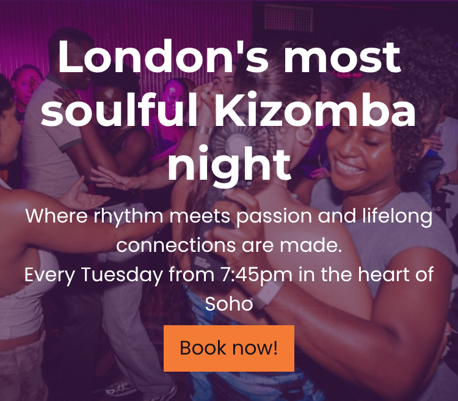 |

The purple overlay keeps the white text readable over the photo at every size.

- **Footer:** contact email (clickable), venue address, links to Instagram, Facebook, TikTok and the WhatsApp group, quick links to key sections, and a mailing list sign-up (shown from 992px wide- improve usability as it is already contained earlier on in the page).

#### Footer
| Desktop | Tablet | Mobile |
|---|---|---|
|  |  |  |

Three columns on desktop. On smaller screens the subscribe form is hidden and the columns stack.

- **Page fade:** each page fades in on load (skipped for visitors with reduced motion turned on).

### Home (`index.html`)

- Hero image with the headline "London's most soulful Kizomba night" and a **Book now!** button. Button created with Bootstrap and styled using Boostrap variables and own CSS styles.
- Photo carousel of 20 landscape photos from previous nights, next to a sign-up form for a free class. Only landscape photos are used so the carousel doesn't jump in height between slides, and each slide loads only when it's needed (`loading="lazy"`)
- "Why dance with us?" cards: levels for everyone, community, music and confidence created with Bootstrap. Card image shape changed to circular and card shape itself has sharp corners and not the default rounded corners. 

### Classes (`classes.html`)

- Schedule, prices and levels for the class and social, alongside the event flyer
- **Book a class** button linking to the booking page (Afromoya). Button created with Bootstrap and styled using Boostrap variables and own CSS styles.
- Meet your instructors cards, created with bootstrap. Shape of the card image changed to a circle and the card shape has sharp corners compared to the bootstrap default of rounded corners.
- FAQs using expandable `
` sections. Thought about using a Bootstrap accordion however it would take up a lot of space for such a small section. 

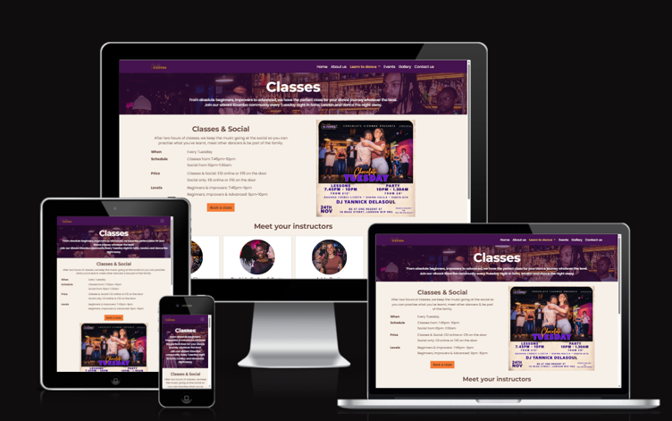

### Contact Us (`contact-us.html`)

- Contact form (name, email, subject, message) created with Bootstrap and dsent with Web3Forms, with hidden spam protection. 
- Connect with us links (WhatsApp, Instagram, Facebook)
- Opening hours, venue address and a **Get Directions** link to Google Maps

### Message sent (`success.html`)

- Thank-you page shown after the contact form is submitted, with a link back to the home page
- Hidden from search engines with `noindex`

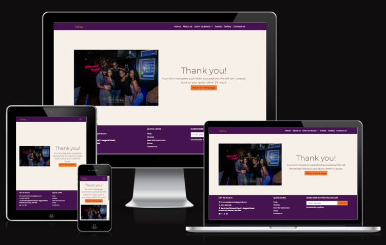

### Signed up (`thank-you.html`)

- Thank-you page shown after someone joins the mailing list, from either the free-class sign-up on the home page or the footer sign-up on any page
- Confirms the free class is on its way, with a link back to the home page
- Hidden from search engines with `noindex`

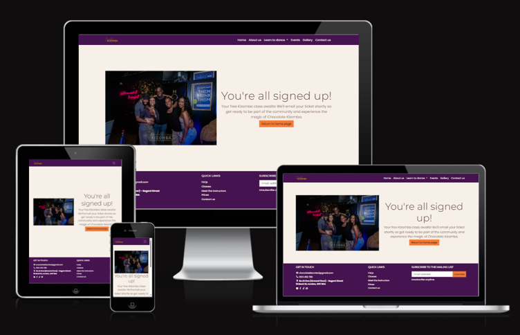

### Under construction (`under-construction.html`)

- Placeholder page for sections that aren't built yet: About us, Workshops, Events and Gallery all link here from the navbar
- Tells visitors the page is on its way, with a link back to the home page
- Hidden from search engines with `noindex`

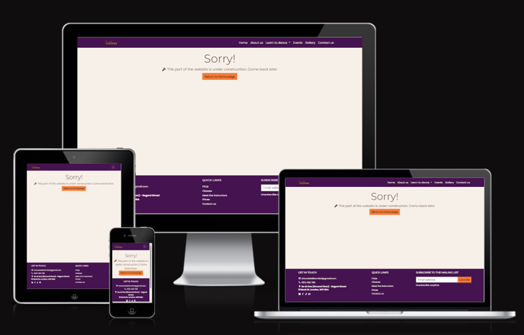

---

## Future features

- **About us page:** the story behind Chocolate Kizomba and the team. Add a "What is Kizomba section?" explaining the roots and cultural significance. Short videos with highlights.
- **Workshops page:** upcoming workshops with booking links (under "Learn to dance"). Fuller class descriptions with learning objectives for each level.
- **Events page:** calendar of socials and special events and guest teachers. A weekly "This Tuesday" section showing the DJ playing that week, with a direct booking link.
- **Gallery page:** photos and videos from past nights
- **Mailing list:** move the free-class and footer sign-up forms from Web3Forms to Mailjet, so subscribers go straight onto a mailing list instead of arriving as emails
- **Privacy policy page**, linked from the sign-up forms

The About us, Workshops, Events and Gallery links already appear in the navbar to show the planned site structure. Until those pages are built, they open the under construction page.

---

## Accessibility

- Semantic HTML elements
- Keyboard-friendly navigation
- Logical heading order on every page (`h1`, then `h2`, then `h3`), using Bootstrap's heading classes to control size separately especially for smaller heading sizes
- Descriptive `alt` text for every image used
- Labels for every form field, with `autocomplete` to help people fill them in
- `aria-label`s on icon-only links (the footer social icons), and decorative icons hidden from screen readers
- Visible focus and hover states on buttons and links
- `lang="en-GB"` on every page
- Fade animation turned off for visitors with reduced motion turned on

---

## Technologies

- HTML5 and CSS3
- [Bootstrap 5.3](https://getbootstrap.com/): grid, navbar, carousel, cards and forms
- [Font Awesome](https://fontawesome.com/): icons
- [Google Fonts](https://fonts.google.com/): Montserrat and Poppins
- [Web3Forms](https://web3forms.com/): sends contact form messages and mailing list sign-ups to email
- [favicon.io](https://favicon.io/): favicons
- Git, GitHub and GitHub Pages: version control and hosting
- Visual Studio Code

---

## Testing & Validation

Full testing and validation results can be found in the [TESTING.md](TESTING.md) file.

### Validators

| Page                    | W3C HTML validator                                                                                                          | Result |
| ----------------------- | --------------------------------------------------------------------------------------------------------------------------- | ------ |
| index.html              | 0 errors, 0 warnings                                                                                                        | Pass   |
| classes.html            | 0 errors, 0 warnings                                                                                                        | Pass   |
| contact-us.html         | 0 errors, 0 warnings (after removing `autocomplete` from the hidden spam-check checkbox, which isn't allowed on checkboxes) | Pass   |
| success.html            | 0 errors, 0 warnings                                                                                                        | Pass   |
| thank-you.html          |                                                                                                                             |        |
| under-construction.html |                                                                                                                             |        |

| File       | W3C CSS validator                                                                                        | Result |
| ---------- | -------------------------------------------------------------------------------------------------------- | ------ |
| styles.css | 0 errors. 3 standard notices: the Google Fonts `@import` isn't checked, and CSS variables aren't checked | Pass   |

### Lighthouse

| Page            | Performance | Accessibility | Best Practices | SEO |
| --------------- | ----------- | ------------- | -------------- | --- |
| index.html      |             |               |                |     |
| classes.html    |             |               |                |     |
| contact-us.html |             |               |                |     |

### Responsiveness

Checked with screenshots in Microsoft Edge. Still to check by hand in DevTools: 375, 576, 992 and 1400px.

| Page                    | 320px | 768px   | 1200px  | Notes                                                                                           |
| ----------------------- | ----- | ------- | ------- | ----------------------------------------------------------------------------------------------- |
| index.html              | Pass  | Pass    | Pass    | Cards: 1, then 2, then 4 per row. Carousel and sign-up stack on mobile, side by side from 768px |
| classes.html            | Pass  | Pass    | Not yet | Hero grows to fit its text on mobile. Details switch to label/value pairs from 576px            |
| contact-us.html         | Pass  | Not yet | Pass    | Form, then Connect / Opening Hours / Find us in three columns from 768px                        |
| success.html            | Pass  | Pass    | Not yet | Message shows above the photo on mobile, beside it from 768px                                   |
| thank-you.html          |       |         |         | Same layout as success.html                                                                     |
| under-construction.html |       |         |         |                                                                                                 |

No page scrolls sideways at 320px.

### Manual testing

| Test                                                     | Expected result                                                                     | Result                                                                                                                  |
| -------------------------------------------------------- | ----------------------------------------------------------------------------------- | ----------------------------------------------------------------------------------------------------------------------- |
| Navbar links                                             | Each link opens the right page                                                      | Pass (every local link and image checked with a script)                                                                 |
| Placeholder links (About us, Workshops, Events, Gallery) | Open the under construction page                                                    |                                                                                                                         |
| Mobile menu                                              | Opens, dropdown works, closes                                                       |                                                                                                                         |
| Home page carousel                                       | All 20 slides show sharp photos, with no blank slides or noticeable jumps in height |                                                                                                                         |
| Footer quick links                                       | Open the right section of the Classes page                                          | Pass (`#faqs`, `#instructors` and `#classes` all exist)                                                                 |
| Social links                                             | Open in a new tab                                                                   | WhatsApp, Instagram, TikTok, Google Maps and Afromoya all respond. Facebook blocks automated checks, so test it by hand |
| Contact form, empty submit                               | Browser asks for the missing fields                                                 |                                                                                                                         |
| Contact form, invalid email                              | Browser asks for a valid email                                                      |                                                                                                                         |
| Contact form, real message                               | Email arrives and success.html is shown                                             |                                                                                                                         |
| Free-class sign-up (home page), real email               | Email arrives and thank-you.html is shown                                           |                                                                                                                         |
| Footer sign-up (each page, from 992px), real email       | Email arrives and thank-you.html is shown                                           |                                                                                                                         |
| Sign-up forms, empty or invalid email                    | Browser asks for a valid email                                                      |                                                                                                                         |
| Book now / Book a class                                  | Booking page opens in a new tab                                                     |                                                                                                                         |
| Keyboard only                                            | Every link and button can be reached and focus is visible                           |                                                                                                                         |

### Browsers

Chrome, Firefox, Safari (including iOS) and Edge.

---

## Bugs fixed

| Bug                                                                                                                                                                                                                                                         | Fix                                                                                                                                                                                        |
| ----------------------------------------------------------------------------------------------------------------------------------------------------------------------------------------------------------------------------------------------------------- | ------------------------------------------------------------------------------------------------------------------------------------------------------------------------------------------ |
| Thin gap between the fixed navbar and the hero after changing the font                                                                                                                                                                                      | Updated the body's `padding-top` to match the navbar's new height                                                                                                                          |
| Headings linked from the footer were hidden under the fixed navbar                                                                                                                                                                                          | Added `scroll-padding-top` to `html`                                                                                                                                                       |
| White text on orange buttons failed contrast checks (2.7:1)                                                                                                                                                                                                 | Changed button text to Charcoal (6.8:1)                                                                                                                                                    |
| Buttons grew on hover and went see-through when clicked                                                                                                                                                                                                     | Styled buttons through Bootstrap's `--bs-btn-*` variables                                                                                                                                  |
| Hero text was cut off on small phones                                                                                                                                                                                                                       | Changed the hero from `height` to `min-height`                                                                                                                                             |
| The `h3+.h5` selector didn't style headings                                                                                                                                                                                                                 | Changed it to `h3, .h5`                                                                                                                                                                    |
| Images used backslashes in their paths, which break on web servers                                                                                                                                                                                          | Changed every path to forward slashes                                                                                                                                                      |
| Large images (up to 6MB each) slowed the pages                                                                                                                                                                                                              | Resized and compressed every image (106MB down to about 8MB)                                                                                                                               |
| JPG photos and PNG logos were larger than they needed to be                                                                                                                                                                                                 | Converted them to WebP (the three logos went from 295KB to 121KB)                                                                                                                          |
| Some photos looked blurry after the WebP conversion (carousel images 1, 9, 10 and 22, the classes hero, the success and thank-you photo, two card images and the flyer). They had been saved at as little as 270px wide, so the browser was stretching them | Rebuilt them as WebP from the full-size originals (1080px wide, and 1240px for the flyer). Carousel images 4, 5, 8, 13 and 14 were rebuilt the same way before being added to the carousel |

---

## Deployment

The project was deployed using **GitHub Pages** from the main branch and is also being hosted there.

---

## Credits

- Layout components: [Bootstrap](https://getbootstrap.com/)
- Colour palette: [Coolors](https://coolors.co/)
- Icons: [Font Awesome](https://fontawesome.com/)
- Fonts: [Google Fonts](https://fonts.google.com/)
- Favicons: [favicon.io](https://favicon.io/)
- Contact form handling: [Web3Forms](https://web3forms.com/)
- Bookings: [Afromoya](https://www.afromoya.com/)
- Wireframes: [Claude](https://claude.ai/)
- Photos: Chocolate Kizomba (saved from Google Drive)
