# Chocolate Kizomba Testing & Validation

## Table of Contents

- [Testing & Validation](#testing--validation)
  - [CSS Validation](#css-validation)
  - [HTML Validation](#html-validation)
  - [Lighthouse Validation and Results Summary](#lighthouse-validation-and-results-summary)
    - [Home Page](#indexhtml)
    - [Classes Page](#classeshtml)
    - [Contact Us Page](#contact-ushtml)
    - [Message Sent Page](#successhtml)
    - [Thank You Page](#thank-youhtml)
    - [Under Construction Page](#under-constructionhtml)
- [Performance](#performance)
- [Responsiveness](#responsiveness)
- [Bugs fixed](#bugs-fixed)

---
## Testing & Validation

This document outlines the testing and validation processes carried out for the Chocolate Kizomba project. These include HTML, and CSS Validation, as well as performance, accessibility, best practices, and SEO testing using Lighthouse.

### CSS Validation

CSS validation was conducted using the W3C CSS Validation Service to ensure the stylesheet complies with current CSS standards. The project’s main stylesheet validated successfully with no errors found.

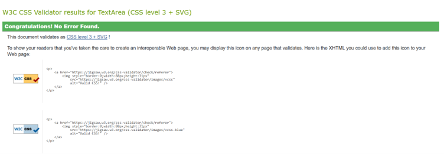

---

### HTML Validation

HTML validation was carried out using the W3C Nu HTML Checker. Every HTML page in the project was individually tested and returned no errors or warnings.

The following pages were validated (the subsequent screenshots are shown in this order):

- Home page
- Classes page
- Contact Us page
- Success page (Message sent)
- Thank you page (Signed up)
- Under Construction page

Initially, minor warnings were identified relating to "trailing slashes" left throughout the code on each page. Once removed, no errors were found.

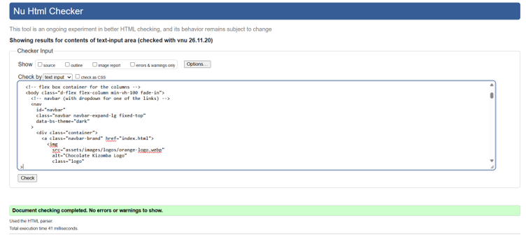
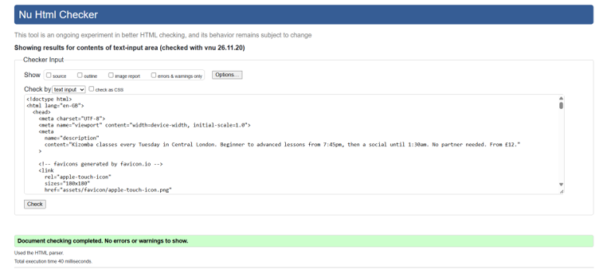
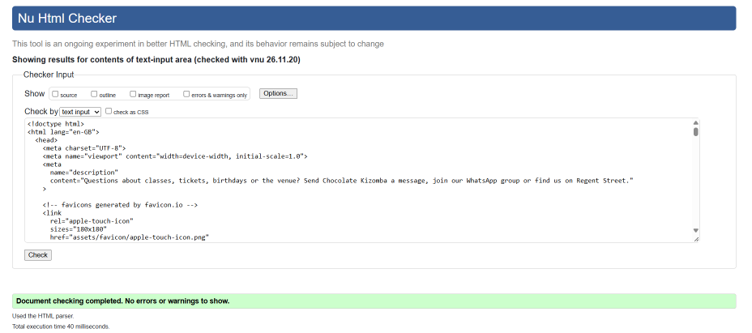
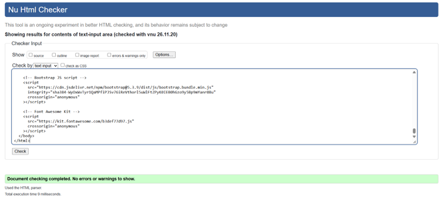
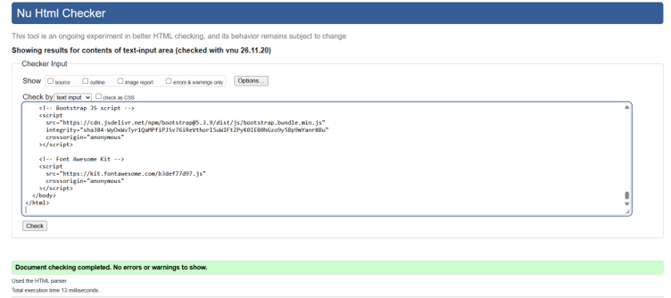

---

### Lighthouse Validation and Results Summary

Tested on the live site in an Incognito window. "Before" is the first test; "After" is after the changes in [Performance](#performance).

#### index.html

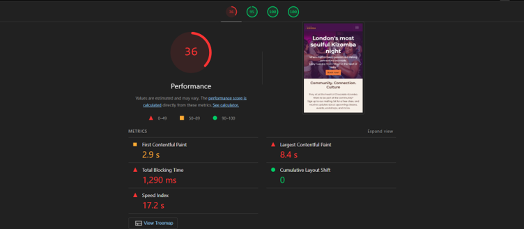

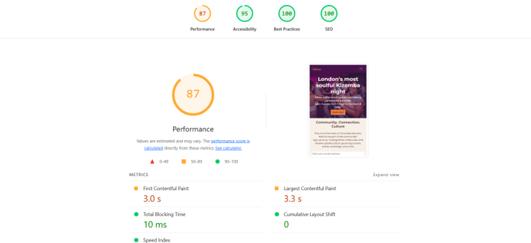

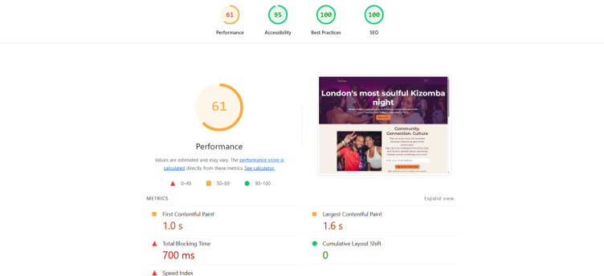

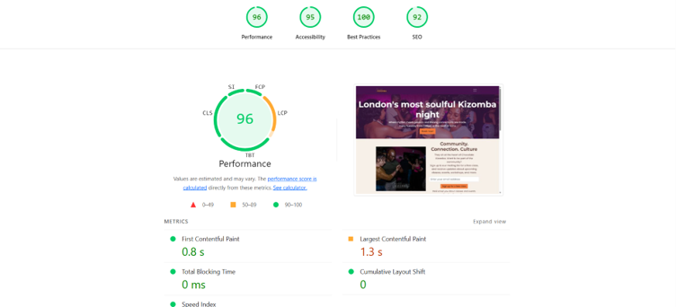

#### classes.html

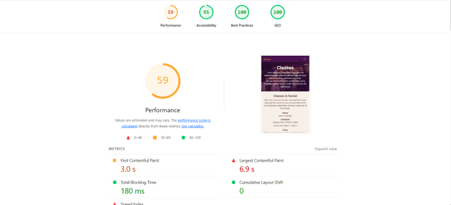

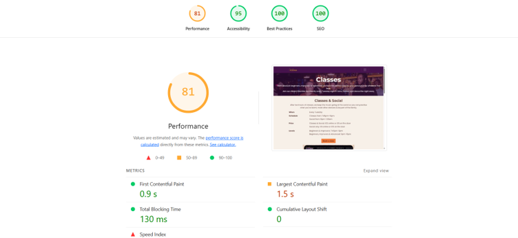

#### contact-us.html

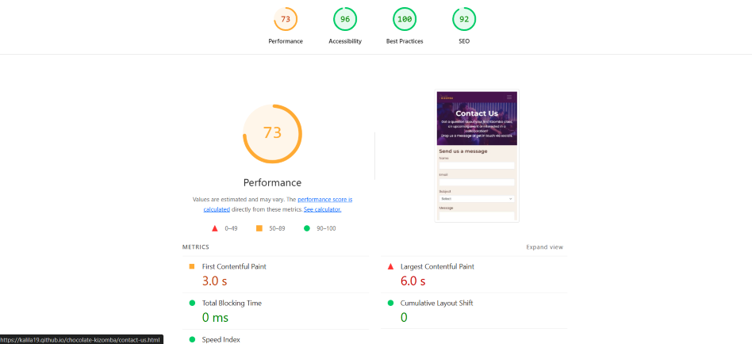

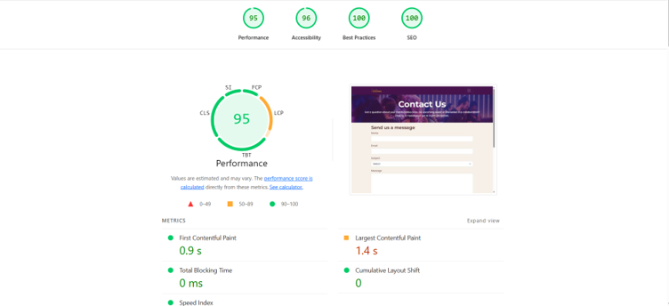

#### success.html

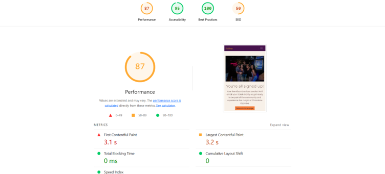

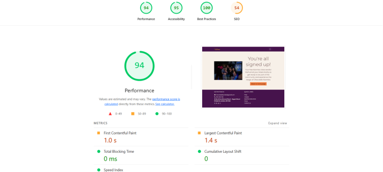

#### thank-you.html

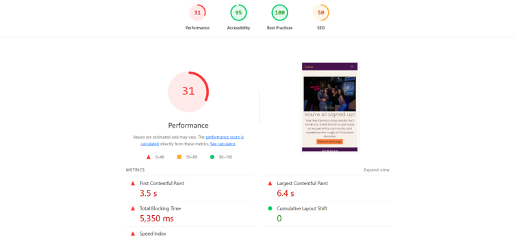

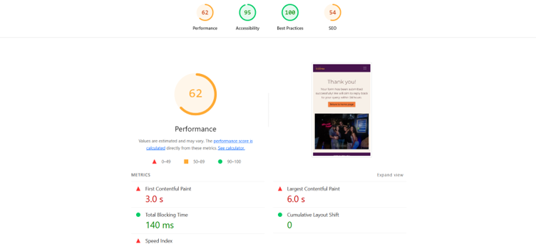

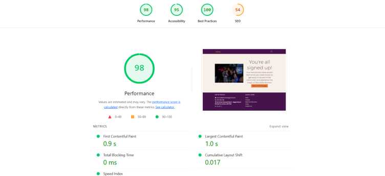

#### under-construction.html

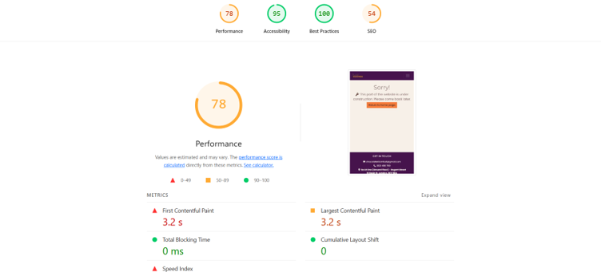

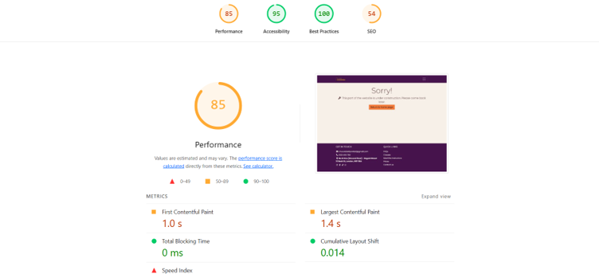

---

## Performance

The first Lighthouse tests gave low Performance scores: **36 on mobile and 76 on desktop** for the home page, and **37–41 on mobile** for the thank-you page. Lighthouse's mobile test simulates a mid-range phone on a slow 4G connection, so large files and slow-loading resources have a big effect. The following changes were made in response:

| Change | Why it helps |
| ------ | ------------ |
| **Re-compressed 50 WebP images at quality 78**, keeping the same names and dimensions. Total size went from 9.0MB to 1.7MB, and the home hero went from 277KB to 44KB | The WebP files had been saved at very high quality, so each was about 6 times bigger than it needed to be. Images were the biggest part of each page's download |
| **Resized the success and thank-you image** from 1080px to 800px wide (72KB to 37KB) | Lighthouse's "Improve image delivery" check showed the image was larger than the size it's displayed at |
| **Moved Google Fonts from a CSS `@import` into each page's `<head>`,** with `preconnect` and only the weights used | With `@import`, the browser had to download `styles.css` before it could even discover the fonts. Loading them from the HTML lets them download in parallel, and requesting only 9 weights instead of every weight from 100 to 900 means less to download |
| **Added `preconnect` for the Bootstrap CDN** (`cdn.jsdelivr.net`) | Opens the connection to the server earlier, which reduces the "render-blocking requests" delay |
| **Added `fetchpriority="high"`, `width` and `height` to the hero images** | Tells the browser to download the largest visible image first, which improves Largest Contentful Paint. The dimensions reserve space so the layout doesn't jump as images load, which improves Cumulative Layout Shift |
| **Lazy loading (`loading="lazy"`)** on images below the fold | Images further down the page only download when the visitor scrolls near them. It isn't used on the first carousel slide or the logo, because they're visible straight away |
| **Reduced the carousel from 20 slides to 10** | Fewer images, and a lighter page overall |
| **Shortened the page fade-in** from 0.4s to 0.2s | The page starts invisible (opacity 0), so Lighthouse counts content as shown only once the fade finishes |

---

## Responsiveness

Checked in Chrome DevTools at 320, 375, 576, 768, 992, 1200 and 1400px.

| Page                    | 320px | 768px   | 1200px  | Notes                                                                                           |
| ----------------------- | ----- | ------- | ------- | ----------------------------------------------------------------------------------------------- |
| index.html              | Pass  | Pass    | Pass    | Cards: 1, then 2, then 4 per row. Carousel and sign-up stack on mobile, side by side from 768px |
| classes.html            | Pass  | Pass    | Pass    | Hero grows to fit its text on mobile. Details switch to label/value pairs from 576px            |
| contact-us.html         | Pass  | Pass     | Pass    | Form, then Connect / Opening Hours / Find us in three columns from 768px                        |
| success.html            | Pass  | Pass    | Pass     | Message shows above the photo on mobile, beside it from 768px                                   |
| thank-you.html          | Pass  | Pass    | Pass    | Same layout as success.html                                                                     |
| under-construction.html | Pass  |  Pass       |  Pass      |                                                                                                 |

No page scrolls sideways at 320px.

---

## Bugs fixed

| Bug | Fix |
| --- | --- |
| Thin gap between the fixed navbar and the hero after changing the font | Updated the body's `padding-top` to match the navbar's new height |
| Headings linked from the footer were hidden under the fixed navbar | Added `scroll-padding-top` to `html` |
| White text on orange buttons failed contrast checks (2.7:1) | Changed button text to Charcoal (6.8:1) |
| Buttons grew on hover and went see-through when clicked | Styled buttons through Bootstrap's `--bs-btn-*` variables |
| Hero text was cut off on small phones | Changed the hero from `height` to `min-height` |
| The `h3+.h5` selector didn't style headings | Changed it to `h3, .h5` |
| Images used backslashes in their paths, which break on web servers | Changed every path to forward slashes |
| Large images (up to 6MB each) slowed the pages | Resized and compressed every image (106MB down to about 8MB) |
| JPG photos and PNG logos were larger than they needed to be | Converted them to WebP (the three logos went from 295KB to 121KB) |
| Some photos looked blurry after the WebP conversion (carousel images 1, 9, 10 and 22, the classes hero, the success and thank-you photo, two card images and the flyer). They had been saved at as little as 270px wide, so the browser was stretching them | Rebuilt them as WebP from the full-size originals (1080px wide, and 1240px for the flyer). Carousel images 4, 5, 8, 13 and 14 were rebuilt the same way before being added to the carousel |
| The HTML validator showed info messages for trailing slashes on void elements (for example ` `) | Removed the trailing slashes from every page |
| The HTML validator flagged `autocomplete` on the hidden spam-check checkbox, which isn't allowed on checkboxes | Removed the attribute |
| Lighthouse Performance was low (36 mobile, 76 desktop on the home page) | See [Performance](#performance): images re-compressed, Google Fonts moved into the HTML, `preconnect` and `fetchpriority` added, and the fade-in shortened |
| After removing carousel slides, the "Community. Connection. Culture" text dropped underneath the carousel in a narrow column. The `
` closing `.carousel-inner` had been deleted with the slides, so the text sat inside the carousel's column | Found by comparing the number of opening and closing `
` tags, then added the missing `
` |
| `contact-us.html` was accidentally overwritten in the same commit, leaving only a few lines (the page showed just "re") | Restored the complete file from the previous commit with `git checkout <commit> -- contact-us.html` |

---
