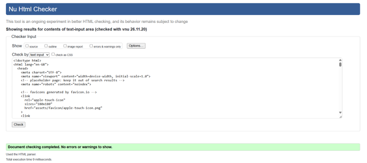

# Chocolate Kizomba Testing & Validation

## Table of Contents

 [Testing and Validation](#testing-and-validation)
- [CSS Validation](#css-validation)
- [HTML Validation](#html-validation)
- [Lighthouse Validation](#lighthouse-validation)
  - [Lighthouse Score Reference](#lighthouse-score-reference)
- [Lighthouse Results Summary](#lighthouse-results-summary)
  - [Home Page](#home-page)
  - [About Page](#about-page)
  - [Locations Page](#locations-page)
  - [Menu Page](#menu-page)
  - [Tavern Code & FAQ Page](#tavern-code--faq-page)
  - [Gallery Page](#gallery-page)
  - [Contact Page](#contact-page)
  - [Feedback / Message Received Page](#feedback--message-received-page)
  - [Under Construction Page](#under-construction-page)
- [Performance Considerations and Impact](#performance-considerations-and-impact)
  - [Lazy Loading Performance Impact](#lazy-loading-performance-impact)
- [Conclusion](#conclusion)

## Testing & Validation

This document outlines the testing and validation processes carried out for the Chocolate Kizomba project. These include HTML, and CSS Validation, as well as performance, accessibility, best practices, and SEO testing using Lighthouse.

### CSS Validation

CSS validation was conducted using the W3C CSS Validation Service to ensure the stylesheet complies with current CSS standards. The project’s main stylesheet validated successfully with no errors found,

---

### HTML Validation

HTML validation was carried out using the W3C Nu HTML Checker. Every HTML page in the project was individually tested and returned no errors or warnings.

The following pages were validated (the subsequent screenshots are shown in this order):

Home page
Classes page
Contact Us page
Success page (Message sent)
Thank you page (Signed up)
Under Construction page

Initially, minor warnings were identified relating to:

"trailing slashes" left throughout the code on each page. Once removed no errors were found.

### Lighthouse Validation 